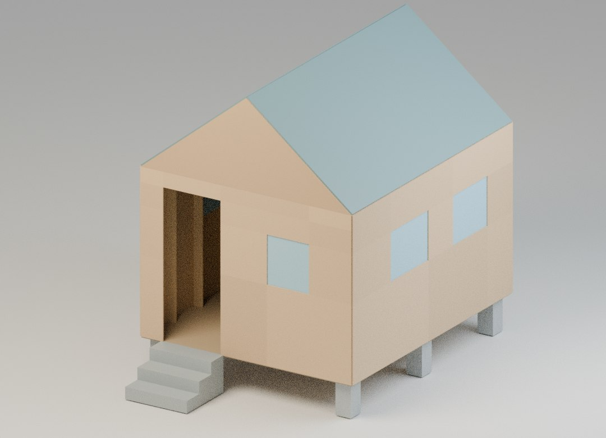

# Raised gable cabin | MIT 4.500 Lecture 7 study

An independently modelled interpretation of the small, raised gable-roof cabin on the left of PDF page 17. The lecture shows a plywood assembly system and several prototypes. Page 13 illustrates joinery families, page 14 pairs a design model with a construction model, and pages 21–25 progress from design to parts, cutting and assembly. The tall asymmetric variant is a different form. Download the [MIT lecture](https://ocw.mit.edu/courses/4-500-introduction-to-design-computing-fall-2008/c64a0210b22a86cff391423296b8d428_lec7.pdf). See also [Sass and Botha's publication](https://doi.org/10.1260/147807706779399015) and [MIT's prototype history](https://ddf.mit.edu/project-summary-2/).



## Model and drawings

| Output | Use |
|---|---|
| [Editable Blender scene](outputs/cabin.blend) | Inspect roof, wall, floor, glazing, illustrative ribs and supports as separate collections. Hide the roof or wall skins in the Outliner to inspect the interior. |
| [IFC4](outputs/cabin.ifc) | Exchange a geometry and classification reference with an IFC tool such as Bonsai. Each object has a stable descriptive name and a study property set. The mesh-based model uses independent components. |
| [GLB](outputs/cabin.glb) | Portable geometry and materials for other viewers. |
| [Plan, south elevation and joint sketch](outputs/overview.svg) | Review the assumed geometry, levels and openings. The tab-and-slot graphic is schematic. |
| [Material estimate](outputs/materials.csv), [rectangular parts](outputs/rectangular-parts.csv), [sheet layout](outputs/stock-layout.svg) | Inspect which geometry contributes to the sheet estimate and which systems still need detailed design. |

### Source versus model assumptions

The lecture supports the raised, single-room form with a gable roof, exterior steps and panel/rib assembly language. It does not provide a reliable dimensioned floor plan and complete connection schedule for the selected view. The editable assumptions in `design.json` use **3,000 × 3,600 mm** plan datum, **+480 mm** floor datum, **2,200 mm** wall height and **1,200 mm** gable rise. Plate thickness is **18 mm** in this study. The skin extends a plate thickness outside some datum lines. The modeled opening count, location and dimensions are independent design inputs. Foundation and stairs are concept geometry. The rib model illustrates assembly logic, without connectivity, engineering joint dimensions or a verified load path.

The project is suitable for a BIM portfolio, OpenBIM exchange and geometric takeoff. Construction would require a site-specific structural system, grade and thickness selection, connections, weathering, services, and review for local approvals. For New Zealand, use [MBIE's Tiny Houses guidance](https://www.building.govt.nz/getting-started/tiny-houses/guidance-information-and-resources) to check how classification and Building Code requirements apply.

## Material and quantity scope

| Package | Study quantity or next design input |
|---|---|
| Plywood wall skin, floor deck and both roof planes | **24.849 m²**, **10.800 m²**, **13.831 m²** respectively. Combined rectangular stock is **20 sheets** at **2,440 × 1,220 mm**, under the model's edge, spacing and orientation constraints. |
| Triangular gables | **3.600 m²** net. These are visually modelled and measured separately. Real sheet counts require splitting the full-width triangles and nesting them with the chosen edge details. |
| Ribs and structural frame | 29 illustrative rib objects around openings. The frame, plate grade, connection details, anchors and fastener counts require structural design. |
| Exterior moisture and roof | Wall underlay, cavity battens, exterior cladding, flashings and seals. Roof underlay, roof covering, ridge/edge flashing, gutters and downpipes. Account for eaves, overlaps and offcuts after selecting a system. |
| Insulation and linings | Wall, floor and roof/ceiling insulation suited to the intended use and climate. Interior lining, floor finish and ventilation design. |
| Openings and base | Five window openings and one door opening as modeled, with actual frames, glazing and flashings to select. Confirm foundation and hold-downs for the site, safe access, and utility requirements before purchasing. |

The study sheet result includes the rectangular skin/deck pieces only. Gables, illustrative ribs, structural framing, joinery and purchasing allowances are counted separately or left for detailed design.

## Sheet optimization

A MaxRects-style heuristic places each oriented rectangle into a free rectangle, choosing the smallest short-side remainder. Occupancy is expanded to preserve a **6 mm** separation on at least one axis and the actual geometry is kept **10 mm** from board edges. Both numbers are study parameters. The long-stock orientation is fixed. Four deterministic processing orders are tried on identical geometry. The result is **24** sheets in model order, **20** area-descending, **22** height-descending and **20** width-descending. The selected layout uses **83.11%** of the full stock area.

The lower bound is **18 sheets**, from the sum of the net rectangular areas divided by the usable area of one sheet and rounded up. It ignores shape compatibility and the part gap, so **20 is the best layout found**, with a gap of at most two sheets to that lower bound. The SVG lays out review rectangles. Production CAM still needs material-specific tool clearance, hold-down or tabs, grain constraints, panel segmentation and approved part geometry.

## Reproduce locally

The geometry, material tables, drawing and nest run on **Python 3.10+** with the standard library. Blender is used as the editable modelling and presentation tool. Use Bonsai for IFC authoring/review if needed. Rigid-body simulation has no role in the current quantity and geometry checks.

```bash
cd tiny-house-lec7
python -m tinyhouse
python -m unittest discover -s tests -v

# Blender 4.3.2 was used for the checked-in model.
blender -b -t 4 -noaudio --python-exit-code 1 --python export_blender.py

# Optional IFC export and schema validation.
python -m pip install -r requirements-ifc.txt
python export_ifc.py
python -m ifcopenshell.validate outputs/cabin.ifc --rules
```

The six tests check mesh closure, analytical area agreement, invalid openings, placement uniqueness, stock boundaries and minimum gap, and the sheet-count comparison.
